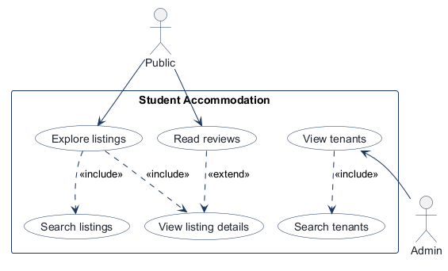
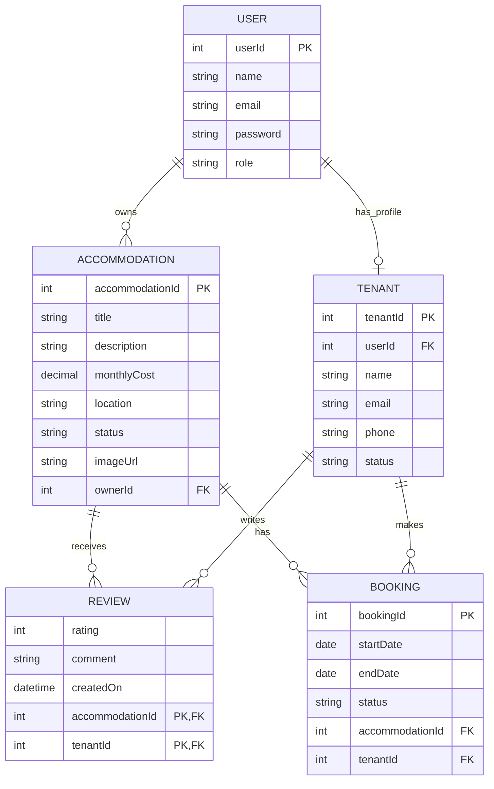
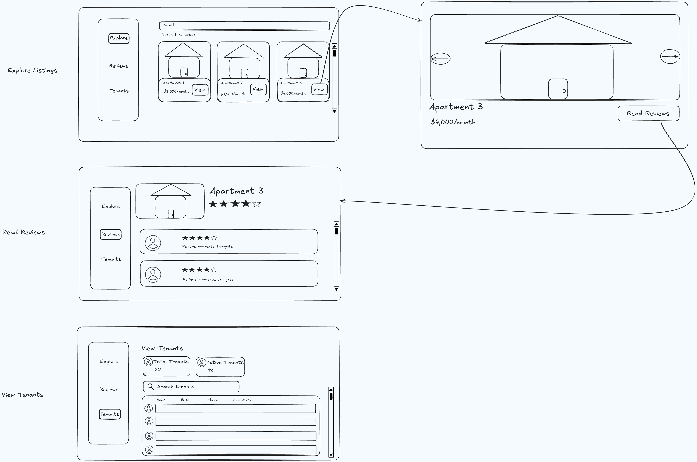

<!-- student-build:skill-integrity
status: pass
root: e84cd692d0b85eefe546385661958c27d07e8be6c5176a82012f68ccff5c8beb
expected_root: e84cd692d0b85eefe546385661958c27d07e8be6c5176a82012f68ccff5c8beb
mismatches: none
-->

# COMP 3613 Assignment 1

Draft this file with the Guide. **Update it after every phase milestone** before you pause. The use-case diagram is a UML PNG at `docs/diagrams/use-case.png`, linked from this file as `diagrams/use-case.png` (path relative to `docs/report.md`). The model diagram is Mermaid. **Embed wireframe images** as `wireframes/<file>` (files live in `docs/wireframes/`).

Do not put your student ID in this file if you will commit it. The PDF cover adds your name and ID at export time.

## Assigned project
Student Accommodation

Phase 1 project/workflow evidence was later added from a partial Guide chat excerpt in `docs/transcripts/phase-1-workflows.md`.

## Three workflows

### 1. Explore listings (public)

### 2. Read reviews (public)

### 3. View tenants (Admin)

## Use case diagram

The workflow labels identify Public as the actor for listing exploration and reviews and Admin for tenant views. The student specified that Explore listings includes Search listings and that View tenants includes Search tenants. Explore listings also includes View listing details; Read reviews extends View listing details.

## Model diagram

First draft based on the student-named entities and properties. Update this section in Phase 5 if polish revises the model, and note what changed.

Relationship and edge-case notes: Each Tenant is a one-to-one profile for a User, so `Tenant.userId` is the profile's foreign key. `Booking` links tenants and accommodations and carries the booking dates and status; each booking has its own `bookingId`, and active bookings for one accommodation must not overlap. For the tenant table, show the accommodation from the tenant's current active booking. The Active Tenants count is based on `Tenant.status`; the total and active counts are derived, not stored attributes. A review uses `(accommodationId, tenantId)` as a composite key to enforce one review per tenant per accommodation. Listing status distinguishes available from booked. Admin can view tenant records; public users can browse listings and read reviews. Attribute types are first-draft assumptions. Phase 4 added `Accommodation.imageUrl` because listing cards and details display property images.

## Wireframes

The single student-crafted image covers all three named workflows:

### Assignment 1 wireframe

<!-- student-build:wireframe-coverage
use_case: Explore listings
image: docs/wireframes/Assignment1Wireframe.png
covered: yes
-->

<!-- student-build:wireframe-coverage
use_case: Read reviews
image: docs/wireframes/Assignment1Wireframe.png
covered: yes
-->

<!-- student-build:wireframe-coverage
use_case: View tenants
image: docs/wireframes/Assignment1Wireframe.png
covered: yes
-->

`python manage.py report` also embeds any PNG/JPG still missing from `docs/wireframes/`.

## Theming

Brand: **Stay 4 Students**. Warm earth tones (oatmeal, terracotta, and sage), clean sans-serif typography (DM Sans), and friendly, simple housing-focused copy. Applied the shared brand tokens across the public landing page, login, registration, and authenticated shell. Kept `/config` and the existing auth flows; the placeholder user/admin home screens will be replaced with the named accommodation workflows.

## Implementation notes

### Phase 5 theming

Brand tokens and shared wordmark/copy are applied to the public landing, login, registration, and authenticated shell. The three workflow links are visible in the public and authenticated navigation; `View tenants` is shown only to Admin. Student reported that the links had been missing; this navigation was added in response. The signed-in landing header's “Open app” button was removed at the student's request.

Post-login navigation: Admin users go to the tenant directory. All other signed-in users are sent to the landing page, and the signed-in landing CTA takes them to Explore Listings instead of the unused starter `/app` placeholder. Navigation labels use title case per the student's request. The student confirmed the Bob/Admin redirect errors are fixed.

### Explore listings — implementation and polish complete

Added the Accommodation SQLModel matching the ERD, title/location search in the repository, service delegation, a thin `/listings` route and listing-detail route, and listing/search templates styled to the wireframe. Empty search shows all listings; title and location searches are case-insensitive. The “Read reviews” navigation returns to listings in review-selection mode, where a user chooses an accommodation before opening its reviews. `init` seeds 20 accommodations, 10 Tenant/User profiles, and 200 Reviews (10 per accommodation); listings without a custom image URL show a bundled apartment illustration instead.

Polish: the student reported that Explore Listings and Read Reviews showed horizontal navigation instead of the wireframe's left sidebar. Both now use the shared sidebar layout; public visitors retain a Sign in link, while tenant navigation remains admin-only. The student verified the left navigation and the apartment sample image is now shown when a listing has no custom image.

### Read reviews — polish update

Added a “View listing details” button to the open right side of the review listing summary. It links to the selected accommodation's existing details route. After the student reported it was still too far left, changed the summary to a three-column grid and centered the button within its dedicated right-hand column; on narrow screens, the summary becomes a single column. The student confirmed the button centering is fixed.

<!-- student-build:code-check
workflow: Explore listings
form: snippet
layer: model
architecture_ok: yes
implement_confidence: 0.55
passed: yes
note: Student completed Accommodation fields from the ERD; monthlyCost uses Decimal/Numeric after guided corrections.
-->

<!-- student-build:code-check
workflow: Explore listings
form: snippet
layer: repository
architecture_ok: yes
implement_confidence: 0.55
passed: yes
note: Student implemented title/location matching in the repository.
-->

<!-- student-build:code-check
workflow: Explore listings
form: snippet
layer: service
architecture_ok: yes
implement_confidence: 0.55
passed: yes
note: Student delegated search through the accommodation service.
-->

<!-- student-build:code-check
workflow: Explore listings
form: choice
layer: service
architecture_ok: yes
implement_confidence: 0.55
passed: yes
note: Student selected the service search method as the route-to-results path.
-->

<!-- student-build:code-check
workflow: Explore listings
form: snippet
layer: router
architecture_ok: yes
implement_confidence: 0.55
passed: yes
note: Student implemented a thin route that calls the service and renders the listing page.
-->

Verification: the student opened the Admin page and confirmed the tenant navigation link is visible. The screenshot also showed icon-font ligature names as literal text in the new sidebar links, so those decorative icons were removed. The Logout icon ligature was also removed after the student reported it appeared as duplicate text. The student ran the app and confirmed that Explore Listings, Read Reviews, and View Tenants match their wireframes after the navigation and landing-page polish. The student reported `init` failed because their `.venv` lacked Pydantic; installing the pinned `requirements.txt` resolved the missing imports and `init --no-drop` completed. No dependency manifest was changed.

### Read reviews — implementation and polish complete

The sidebar opens a property selector, and both that selector and each listing detail page lead to reviews for the chosen accommodation. Added a thin review route, repository filtering by accommodation (newest first), service delegation and average-rating calculation, plus the wireframe's property summary, star ratings, avatar placeholders, review comments, and empty state. Student completed the Review rating-bound, repository, service, and route snippets. Student verified the review workflow against the wireframe and requested a persistent left navigation and stronger visual distinction between Reviews and Explore. The sidebar is pinned while page content scrolls, Reviews has an emphasized rating summary and distinct review cards, the sidebar brand links to the landing page, and the top menu/account bar is removed. Guest sign-in remains in the sidebar. The signed-in landing header's “Open app” button was also removed at the student's request. Sidebar workflow/logout link text and the per-property “Read reviews” and “View” buttons are centered under listing details in their respective selectors. The individual review page's “Back to [apartment]” link and apartment detail page's “Back to listings” link share the same inline SVG left-arrow icon, which the student verified looks consistent. Both selector card layouts use a one-column grid with centered actions and a stylesheet cache-busting version.

<!-- student-build:code-check
workflow: Read reviews
form: choice
layer: other
architecture_ok: yes
implement_confidence: 0.80
passed: yes
note: Student chose the property selector followed by reviews for that selected accommodation, matching the wireframe.
-->

<!-- student-build:code-check
workflow: Read reviews
form: snippet
layer: model
architecture_ok: yes
implement_confidence: 0.80
passed: yes
note: Student completed the Review rating constraints to match the five-star scale.
-->

<!-- student-build:code-check
workflow: Read reviews
form: snippet
layer: repository
architecture_ok: yes
implement_confidence: 0.80
passed: yes
note: Student filters reviews by accommodation and orders them newest first.
-->

<!-- student-build:code-check
workflow: Read reviews
form: snippet
layer: service
architecture_ok: yes
implement_confidence: 0.80
passed: yes
note: Student delegates review retrieval through ReviewRepository.
-->

<!-- student-build:code-check
workflow: Read reviews
form: snippet
layer: router
architecture_ok: yes
implement_confidence: 0.80
passed: yes
note: Student's route calls accommodation and review services and renders their data without persistence logic.
-->

### View tenants — implementation and polish complete

Replaced the Admin placeholder with the wireframe's total/active tenant counts, tenant search, and name/email/phone/apartment table. Added Booking with foreign keys to Tenant and Accommodation so an active booking can supply the apartment title; tenants without one display “No current booking.” Directory filtering and counts are handled by the repository, coordinated by the service, and passed by a thin admin route. Student completed and corrected the Booking model, repository, service, and route snippets. The student verified the workflow against the wireframe along with Explore Listings and Read Reviews.

<!-- student-build:code-check
workflow: View tenants
form: snippet
layer: model
architecture_ok: yes
implement_confidence: 0.55
passed: yes
note: Student completed Booking dates, status, and tenant/accommodation foreign keys from the ERD.
-->

<!-- student-build:code-check
workflow: View tenants
form: snippet
layer: repository
architecture_ok: yes
implement_confidence: 0.55
passed: yes
note: Student implemented tenant search with an optional active-booking accommodation join and aggregate counts.
-->

<!-- student-build:code-check
workflow: View tenants
form: snippet
layer: service
architecture_ok: yes
implement_confidence: 0.55
passed: yes
note: Student coordinated directory rows and tenant counts through the repository.
-->

<!-- student-build:code-check
workflow: View tenants
form: snippet
layer: router
architecture_ok: yes
implement_confidence: 0.55
passed: yes
note: Student bound the search query and called the tenant directory service without persistence logic.
-->

## Deployed app

Phase 6. Public Render URL (not localhost). Markers open this to mark the three workflows.

https://

## Logins

Every account a marker needs, including extra users you added. Starter accounts:

- bob / bobpass — regular user
- admin / adminpass — admin
- tenant01 / tenant01pass — sample tenant
- tenant02 / tenant02pass — sample tenant
- tenant03 / tenant03pass — sample tenant
- tenant04 / tenant04pass — sample tenant
- tenant05 / tenant05pass — sample tenant
- tenant06 / tenant06pass — sample tenant
- tenant07 / tenant07pass — sample tenant
- tenant08 / tenant08pass — sample tenant
- tenant09 / tenant09pass — sample tenant
- tenant10 / tenant10pass — sample tenant

## YouTube URL

## Session transcripts

Filled when the Guide builds the report: the agent writes chat markdown into `docs/transcripts/`; `python manage.py report` packages them.

Guide packaged **3** chat(s) in `docs/transcripts/` (and `docs/transcripts.zip`).

Index: [docs/transcripts/INDEX.md](transcripts/INDEX.md)

- [`phase-1-workflows`](transcripts/phase-1-workflows.md)
- [`phase-2-to-5-design-and-tenant-workflow`](transcripts/phase-2-to-5-design-and-tenant-workflow.md)
- [`phase-5-implementation-and-report`](transcripts/phase-5-implementation-and-report.md)

## Competency (student-judge)

Filled by Guide from the student-judge run when this report was built.

**Judged at:** 2026-10-12
**Student / session:** COMP 3613 Student Accommodation; name and ID for the PDF cover still need confirmation
**Evidence pass:** Re-read both available native Copilot chats and current `docs/report.md`, use-case JSON/PNG, wireframe, and refreshed transcript markdown; prior `docs/judge.md` ignored
**Artifact:** Two native GitHub Copilot Guide chats, one user-provided partial Phase 1 excerpt, current report and diagrams, wireframe, and Guide-written transcript markdown
**Phases in evidence:** 1–5 (COMP 3613); Phase 6 deployment not completed

### Totals
| | Count / value |
|--|--|
| Metrics on rubric | 12 (M1–M12) |
| N/A (excluded) | 0 |
| Metrics scored | 12 |
| Scoreable max | 12 × 4 |
| Awarded total | 42 / 48 |
| **Overall (avg of scored)** | **3.5 / 4** |
| Impression mark | 18 / 20 |

## Scorecard

| ID | Metric | Score / 4 | In avg | Evidence |
|----|--------|----------:|:------:|----------|
| M1 | Phase discipline | 3 | yes | The Phase 1 excerpt and later native chats show phase handoffs, a student wireframe before Phase 5 implementation, and workflow-by-workflow build and polish. Phase 6 remains pending. |
| M2 | Problem framing | 3 | yes | The student named three workflows, supplied entity/property and relationship decisions, and specified “Explore listings includes Search listings” and “View tenants includes Search tenants.” |
| M3 | Decision ownership | 3 | yes | Student owned the domain fields and relationships, accepted `Accommodation.imageUrl` after seeing it in the wireframe, and steered repeated UI corrections including “its still too far to the left.” |
| M4 | Artefact-before-code | 4 | yes | Student said “start phase 4 wireframe added”; the composite wireframe covers all three workflows, and the later build tracks those screens and the model. |
| M5 | Verification habit | 3 | yes | Student reported tenant and redirect failures, gave feedback after checking the Read Reviews layout, and finally confirmed “both the centering of the button and the bob/admin redirect errors have been fixed.” |
| M6 | Assignment fit | 4 | yes | Report and code-check evidence show routes calling services, repository persistence, ERD-aligned models, and workflow-specific UI; checks mark the route snippets `architecture_ok: yes`. |
| M7 | Slice explanation | 3 | yes | Student completed model, repository, service, and route snippets. The thin-route checks passed, though explanatory prose was brief and several details needed guided corrections. |
| M8 | Prompt quality | 3 | yes | Phase-specific prompts and concrete, observable refinements included “move the button to the center of the empty space” and the Phase 2 include decisions. |
| M9 | Response to pushback | 4 | yes | Student kept reporting that the button remained left or unchanged, prompting a layout and cache-busting correction, then confirmed the result. |
| M10 | Integrity | 4 | yes | The readable chats show ordinary workflow decisions and refinement, not paste-back or evasion; `docs/report.md` records `student-build:skill-integrity` as `pass`. |
| M11 | Provenance continuity | 4 | yes | The Phase 2 include changes updated the existing use-case diagram and report; later polish adjusted the same named workflows and wireframe implementation. |
| M12 | Sincerity trajectory | 4 | yes | No suspicion rounds were needed; no sincerity blocks or abandonment are present in the available Guide chats. |

## Strengths
- Student supplied the three named workflows, domain entities and properties, relationship choices, and business-rule constraints.
- The student-authored wireframe covers all three workflows; the model and implementation notes track its fields and flows.
- Student snippets covered model, repository, service, and thin-route layers, with architecture-respecting checks recorded.
- Student reported mismatches, requested iterative polish, and confirmed the centering and Bob/Admin redirect fixes.
- Two native Copilot Guide chats and the partial Phase 1 excerpt are represented in the refreshed transcript package; the course skill-integrity marker passes.

## Gaps (priority order)
1. Phase 6 deployment is incomplete: `docs/report.md` still has `https://` rather than a public Render URL. Deployment should follow Phase 5 polish.

## Phase gate status
| Phase | Status | Note |
|-------|--------|------|
| 1 | met | The available student-provided excerpt records Student Accommodation and the three workflows; the original Phase 1 chat is only partially available. |
| 2 | met | Student specified the Search listings and Search tenants includes; the use-case diagram records listing details and the reviews extension. |
| 3 | met | Student supplied entity fields, relationships, foreign-key ownership, and booking/review rules. |
| 4 | met | Student wireframe covers all three workflows; `Accommodation.imageUrl` was added after the wireframe review. |
| 5 | met | Theming, implementation, student verification, and iterative polish are recorded, including final confirmation of the button and redirect fixes. |
| 6 | not met | No public deployed URL is recorded; the report's deployment field remains `https://`. |

## Recommended next practice
- Deploy the polished app to Render and record the public app URL and marker logins in `docs/report.md`.

## Integrity note
- Clean: no evidence of external-assist/paste-back, evasion, or edited course skills in the readable record; the skill-integrity marker passes.

## Provenance flags
- Phase 1 evidence is a user-provided partial excerpt rather than the full native chat. Two later phases have native Copilot chat records; no other provenance concern found.

## Sincerity log summary
- Blocks found: 0 | max round: N/A | min/mean/final confidence: N/A | trend: N/A | cleared: not needed

## Skips
- Skips: 0/3 used. No skipped-question assumptions are recorded in the available chats.

## Skill integrity

Course skills are hashed at export and compared to `.agents/skills.lock.json`. Do not edit `.agents/skills/`, `.cursor/skills/`, or `AGENTS.md`.

- Status: **pass**
- Root: `e84cd692d0b85eefe546385661958c27d07e8be6c5176a82012f68ccff5c8beb`
- none
